# Ökosystem-Karte: cosmos · ufo · kontor (· aiml/exodus)

Stand 2026-10-29.  Diese Datei **zeigt** das Zusammenspiel; die Verträge stehen woanders und
gehen vor: kontor `doc/ecosystem.md` (Wire-Formate), [spec/111](spec/111_ecosystem.md) (cosmos'
Hälfte), [spec/96](spec/96_layer_cache.md) und [spec/110](spec/110_runtime.md) (Schichten,
Laufzeit), ufo `README.md` / `doc/kit.md` (Schichten als Git-Commits, Layer-Kit), aiml
`spec/62` (Pipelines) und `spec/68` (venv).

**Legende** (gilt für alle Flussdiagramme): durchgezogene Kante = gebaut und getestet,
gestrichelte Kante `-.->` = geplant oder nur teilweise da; `⟨…⟩` an einer Kante nennt das
Protokoll bzw. den Befehl.

| Diagramm | Frage |
|---|---|
| [1 Gesamtbild](#1-gesamtbild) | Wer ist was, und wer redet mit wem? |
| [2 Use-Case-Karte](#2-use-case-karte) | Was kann wer tun — und in welchem System passiert es? |
| [3 Lebenslauf einer Schicht](#3-lebenslauf-einer-schicht) | Wo reist ein Stufen-Ergebnis überall hin? |
| [4 Pipeline-Lauf](#4-pipeline-lauf-end-to-end) | Was passiert zwischen „einreichen" und „Abbild in kontor"? |
| [5 Schritt-Entscheidung](#5-ein-schritt-ausführen-oder-wiederverwenden) | Wann läuft ein Schritt, wann wird er wiederverwendet? |
| [6 Rebuild-Kampagne](#6-rebuild-kampagne) | Eine Bibliothek ändert sich — was wird neu gebaut? |
| [7 Kampagnen-Posten](#7-zustände-eines-kampagnen-postens) | Zustände eines Postens |
| [8 Identität](#8-identität-und-zugriff) | Wie meldet man sich an, und wie reden Maschinen miteinander? |
| [9 Config as Code](#9-config-as-code-und-katalog) | Wie wird cosmos aus Dateien konfiguriert? |
| [10 aiml-venv-Kette](#10-vom-nackten-ubuntu-zur-aiml-venv-und-weiter) | Wie entsteht die Werkzeug-Schicht, auf der alles baut? |
| [11 Vertrauen](#11-vertrauensgrenzen) | Was wird wo geprüft? |

---

## 1. Gesamtbild

```mermaid
flowchart LR
    %% ── Akteure ─────────────────────────────────────────────
    subgraph ACT["Akteure"]
        dev(["Entwickler:in"])
        ops(["Operator / Admin"])
        rel(["Release-Verantwortliche"])
        ci(["CI / Werkzeug<br/>(API-Token)"])
        ociuser(["OCI-Client<br/>docker · podman · skopeo · oras"])
    end

    %% ── Fremdsysteme ────────────────────────────────────────
    subgraph EXT["Fremdsysteme"]
        ldap[("LDAP-Verzeichnis")]
        idp[("SAML-IdP")]
        gitremote[("Git-Server<br/>(smart HTTP)")]
        ubuntu[("ubuntu-base<br/>Grundabbild")]
    end

    %% ── cosmos ──────────────────────────────────────────────
    subgraph COS["cosmos — Control Plane"]
        direction TB
        web["Web-Client (WASM/WebGL)<br/>Cluster · Pipelines · Jobs · Konsole"]
        api["cosmos-api<br/>REST /api/v1 → RPC"]
        cosmosd["cosmosd<br/>RPC · Auth · Rollen-Gate · KV"]
        casc["CasC-Erklärung<br/>config + catalog"]
        catalog["Katalog → JobDef"]
        campaign["Kampagnen<br/>(aus kontor-Webhooks)"]
        sched["Lauf-Zuteilung<br/>Matrix → Lanes → Schritte<br/>pause · resume · step · rewind"]
        acache["ActionCache / CAS<br/>Schritt-Schlüssel → output_tree"]
        console["Skript-Konsole<br/>(eigener Prozess)"]
        prov["Agent-Einrichtung<br/>(SSH, libssh)"]
        subgraph NODE["Knoten / Wirt"]
            direction TB
            agent["agent<br/>sys.exec(Bundle)"]
            rt["cosmos-rt<br/>Container: userns · seccomp"]
            overlay["overlayfs<br/>lower = Schichten · upper = Stufe"]
            oci["cosmos-oci<br/>Schnitt → OCI-Layout"]
            ckontor["cosmos-kontor<br/>push · pull"]
        end
    end

    %% ── kontor ──────────────────────────────────────────────
    subgraph KON["kontor — Artefakt-Ablage + Abhängigkeitsgraph"]
        direction TB
        reg["/v2/ OCI-Registry<br/>Blobs · Manifeste · Tags"]
        exrepo["/exodus/&lt;name&gt;/&lt;version&gt;/<br/>exodus.json · package"]
        generic["/generic/&lt;pfad&gt;"]
        kgraph["Graph + /api/v1/impact<br/>rebuild_waves · needs · pins"]
        layersapi["/api/v1/layers/&lt;pipeline&gt;[/&lt;lauf&gt;]"]
        hooks["Webhook-Hub<br/>HMAC · Wiederholung · Zustell-Log"]
        kauth["Auth: lokal · LDAP · SAML<br/>Rollen · API-Tokens"]
        cas[("cas/&lt;sha256&gt;<br/>ein Speicher für alles")]
    end

    %% ── ufo ─────────────────────────────────────────────────
    subgraph UFO["ufo — Git-Client + Schichten"]
        direction TB
        ugit["Objekte · Packs · Refs<br/>clone · fetch · push"]
        ulayer["layer commit · apply · diff · log<br/>refs/layers/&lt;pipeline&gt;/&lt;stufe&gt;"]
        uimage["image export · import · push · pull · record"]
        ukit["Layer-Kit: LayerKit<br/>KontorKit · LayoutKit"]
    end

    %% ── aiml / exodus ───────────────────────────────────────
    subgraph TOOL["aiml / exodus — Werkzeuge"]
        direction TB
        aimlc["aiml-Compiler<br/>JIT · Objekte"]
        libaiml["libaiml.so<br/>Laufzeit + LLVM"]
        venv["aiml-venv /opt/aiml<br/>bin · lib · lib/aiml · env"]
        exodus["exodus build<br/>(Python; Ablösung durch aiml-exodus)"]
    end

    %% ── Kanten: Menschen und Werkzeuge ──────────────────────
    dev -->|"Pipeline schreiben, einreichen"| web
    dev -->|"⟨REST⟩ pipelines/run"| api
    ops -->|"config plan/apply"| api
    ops -->|"Agent einrichten"| prov
    ops -->|"Skript"| console
    ci -->|"⟨Bearer⟩"| api
    ci -->|"⟨PUT⟩ package · ⟨/v2/⟩"| KON
    rel -->|"publish.sh ⟨PUT /exodus/…⟩"| exrepo
    ociuser -->|"⟨docker login + Token⟩"| reg
    web -->|"⟨wss RPC⟩"| cosmosd
    api -->|"⟨ws RPC, derselbe Weg wie der Browser⟩"| cosmosd

    %% ── cosmos innen ────────────────────────────────────────
    casc --> cosmosd
    cosmosd --> catalog
    cosmosd --> sched
    cosmosd --> campaign
    campaign -->|"run_job"| sched
    catalog --> sched
    console -->|"Wirt-Angebote"| cosmosd
    prov -->|"agent + Ladekette nach /opt/cosmos"| agent
    sched -->|"⟨RPC⟩ Schritt-Bundle"| agent
    agent --> rt --> overlay
    agent -->|"Schlüssel, Bäume"| acache
    overlay -->|"upper je Stufe"| oci
    oci -->|"oci:&lt;layout&gt;"| ckontor

    %% ── cosmos ⇄ kontor ─────────────────────────────────────
    ckontor -->|"⟨/v2/ push⟩ push: kontor:&lt;repo&gt;:&lt;tag&gt;"| reg
    ckontor -->|"⟨/v2/ push⟩ cosmos-layers/&lt;pipeline&gt;:&lt;lauf&gt;"| reg
    reg -->|"⟨/v2/ pull⟩ image: kontor:…"| ckontor
    hooks -->|"⟨POST /hooks/kontor⟩ package.published · image.pushed"| api
    reg --> cas
    exrepo --> cas
    generic --> cas
    exrepo -->|"exodus.json"| kgraph
    kgraph -->|"Plan"| hooks
    reg -->|"image.pushed"| hooks
    layersapi -.->|"liest Artefakt-Manifeste"| reg

    %% ── ufo ─────────────────────────────────────────────────
    ulayer -->|"Schichten als Commits"| ugit
    ugit -->|"⟨smart HTTP⟩ push/fetch refs/layers/*"| gitremote
    uimage --> ukit
    ukit -->|"KontorKit ⟨/v2/, UFO_REGISTRY_TOKEN⟩"| reg
    ukit -->|"LayoutKit ⟨Verzeichnis⟩"| oci
    uimage -->|"record: eine Schicht je Stufe"| ulayer
    overlay -.->|"ufo layer commit &lt;upper&gt;"| ulayer
    ulayer -->|"layer apply / --upper / --oci"| overlay

    %% ── Werkzeuge ───────────────────────────────────────────
    exodus -->|"baut"| aimlc
    exodus -->|"baut"| libaiml
    aimlc -->|"aiml venv"| venv
    venv -->|"Schicht /opt/aiml"| overlay
    libaiml -->|"in agent · cosmosd · kontor · ufo"| agent
    rel -.->|"exodus deps install (geplant)"| exrepo

    %% ── Identität ───────────────────────────────────────────
    cosmosd -->|"⟨bind/search⟩"| ldap
    kauth -->|"⟨bind/search⟩"| ldap
    cosmosd -->|"⟨SAML POST⟩"| idp
    kauth -->|"⟨SAML POST⟩"| idp
    ubuntu -->|"image: ubuntu-base"| rt

    classDef actor fill:#fdf6e3,stroke:#b58900,color:#333
    classDef ext fill:#eee8d5,stroke:#93a1a1,color:#333
    class dev,ops,rel,ci,ociuser actor
    class ldap,idp,gitremote,ubuntu ext
```

**Lesart.**  cosmos **führt aus**, kontor **bewahrt auf und rechnet Abhängigkeiten**, ufo
**versioniert Dateisysteme** als Git.  Sie reden nur über HTTP miteinander (kontor-Vertrag
§1), und jedes läuft ohne die anderen.  Alle drei sind aiml-Programme auf `libaiml.so`.

---

## 2. Use-Case-Karte

Mermaid kennt kein UML-Use-Case-Diagramm; die Ovale (`([…])`) sind die Use Cases, gruppiert nach
dem System, in dem sie stattfinden.  Eine Kante zwischen Use Cases heißt „nutzt" (include).

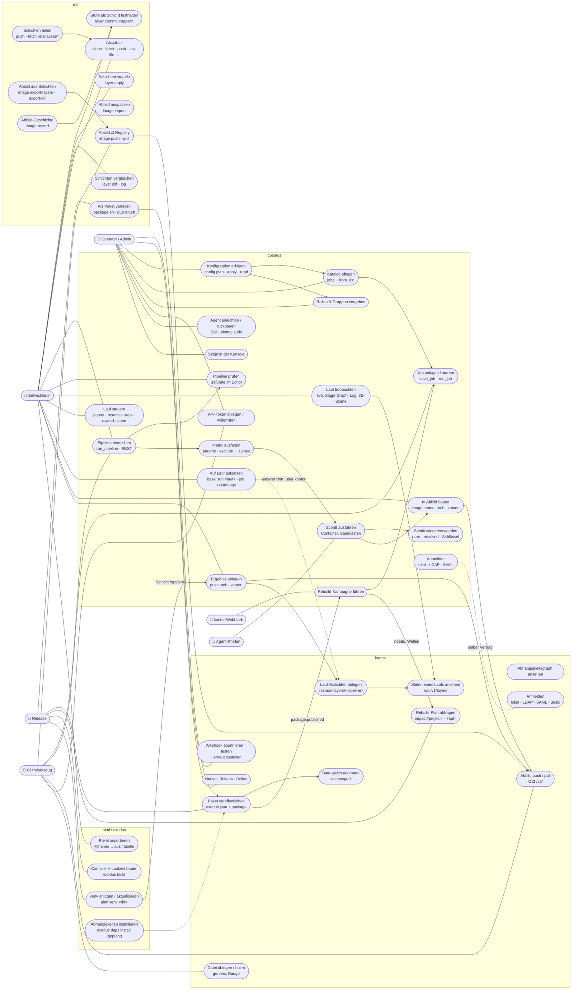

---

## 3. Lebenslauf einer Schicht

Ein Stufen-Ergebnis ist in jedem System **dasselbe Dateisystem**, nur in einer anderen Form:
overlay-upper (cosmos), Git-Baum mit OCI-Whiteouts (ufo), tar+gzip-Blob (OCI, kontor).

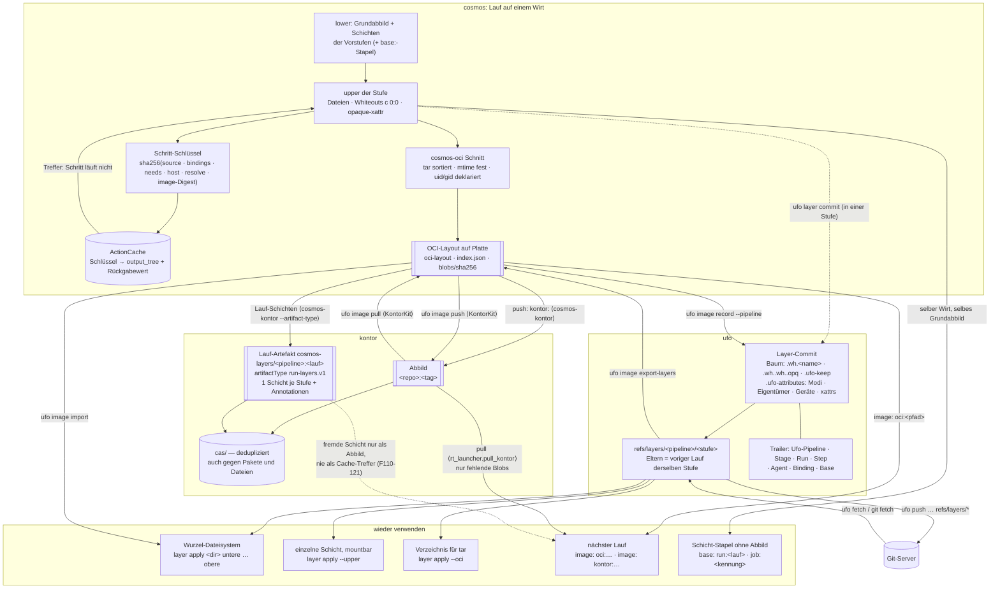

---

## 4. Pipeline-Lauf, End-to-End

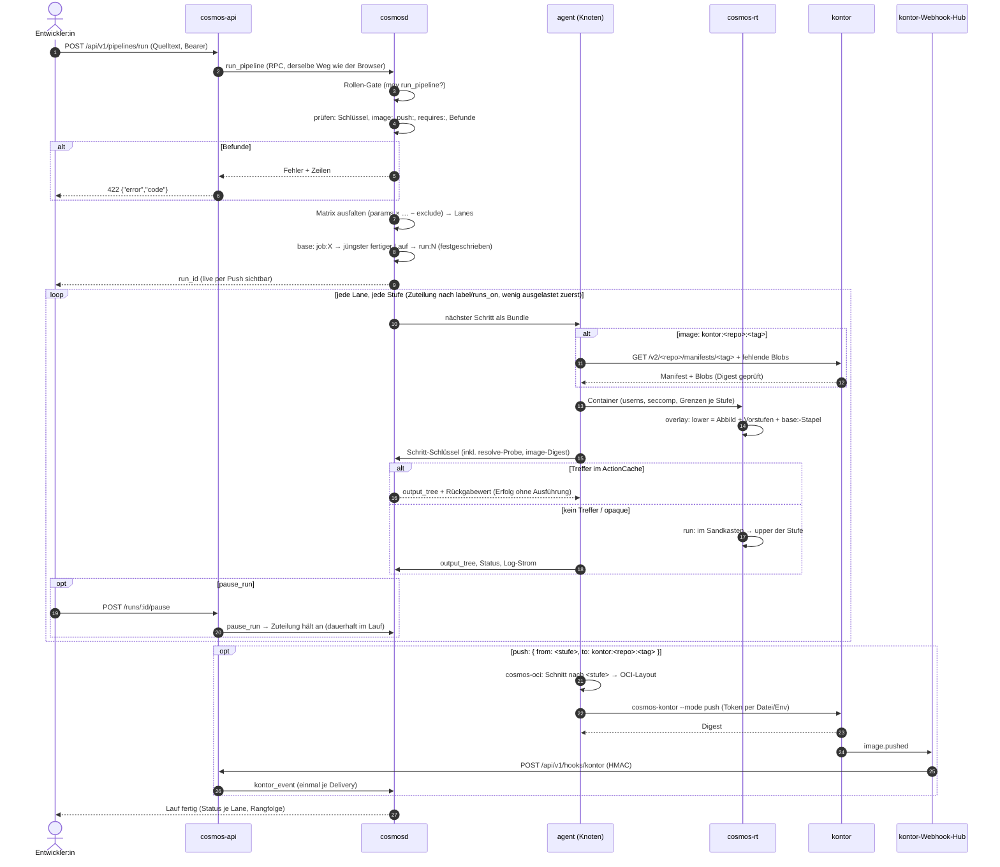

---

## 5. Ein Schritt: ausführen oder wiederverwenden

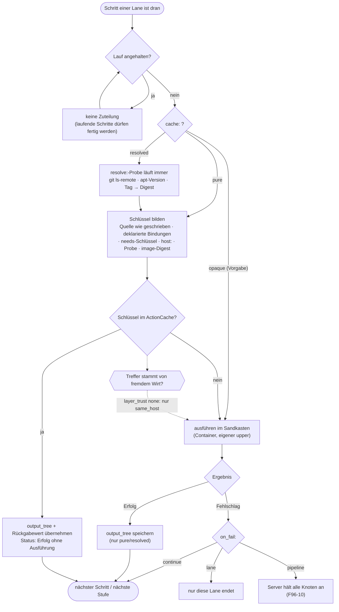

---

## 6. Rebuild-Kampagne

kontor rechnet **was** von was abhängt, cosmos entscheidet **wann** es läuft.

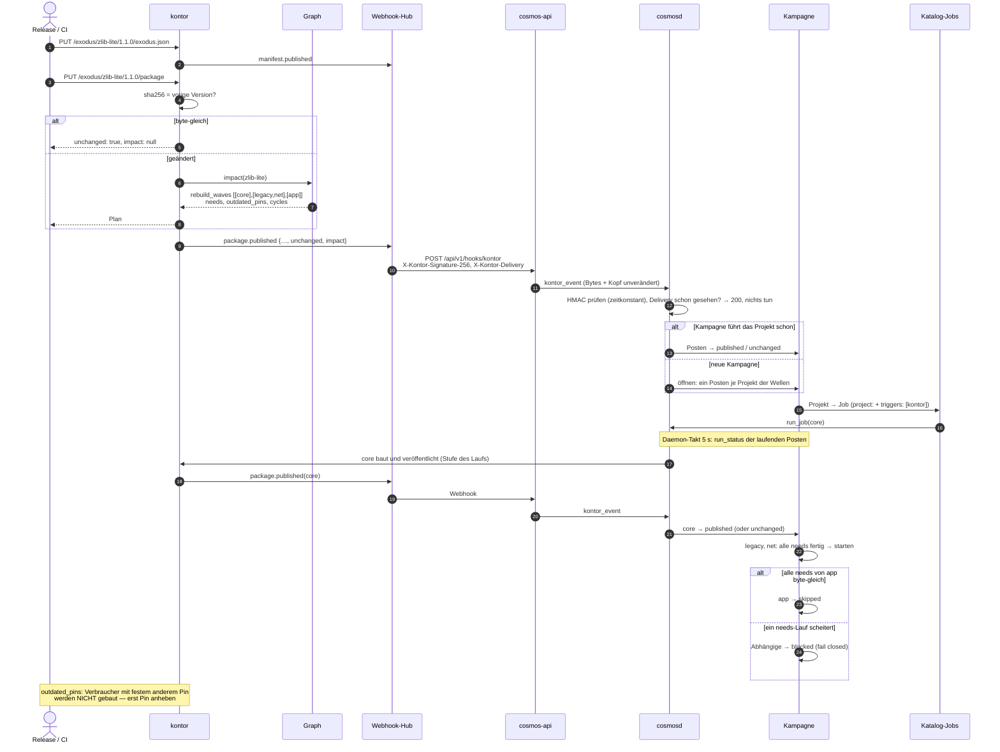

## 7. Zustände eines Kampagnen-Postens

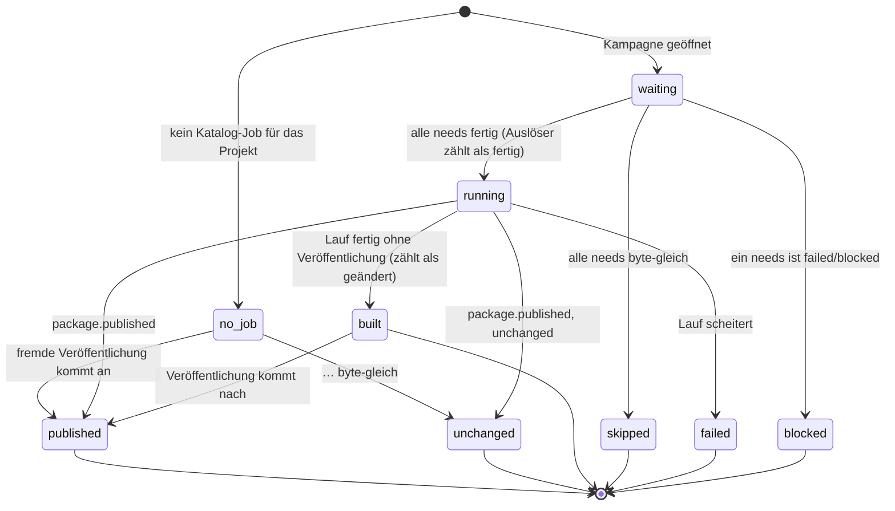

---

## 8. Identität und Zugriff

Beide Seiten erfüllen **denselben** Vertrag (kontor `doc/ecosystem.md` §6) mit denselben
aiml-Bausteinen (aiml `spec/67`): lokal zuerst, dann Verzeichnis; SAML nur auf eigene Anfrage.

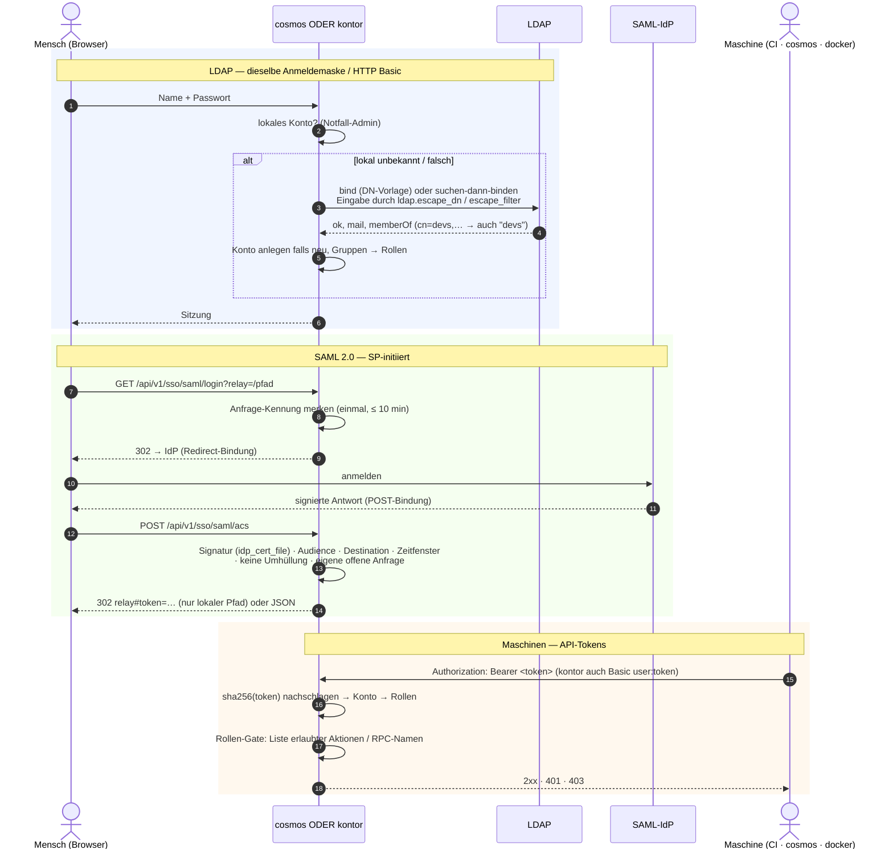

---

## 9. Config as Code und Katalog

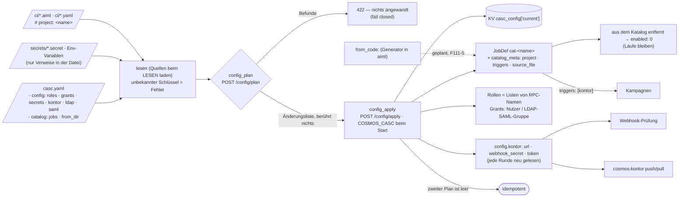

---

## 10. Vom nackten Ubuntu zur aiml-venv — und weiter

Die Werkzeug-Schicht entsteht selbst als cosmos-Lauf.  Seit aiml `spec/68` ist ihr Ergebnis eine
**venv** unter `/opt/aiml`, die ohne Wirtspfade, `ldconfig` oder Symlinks auskommt.

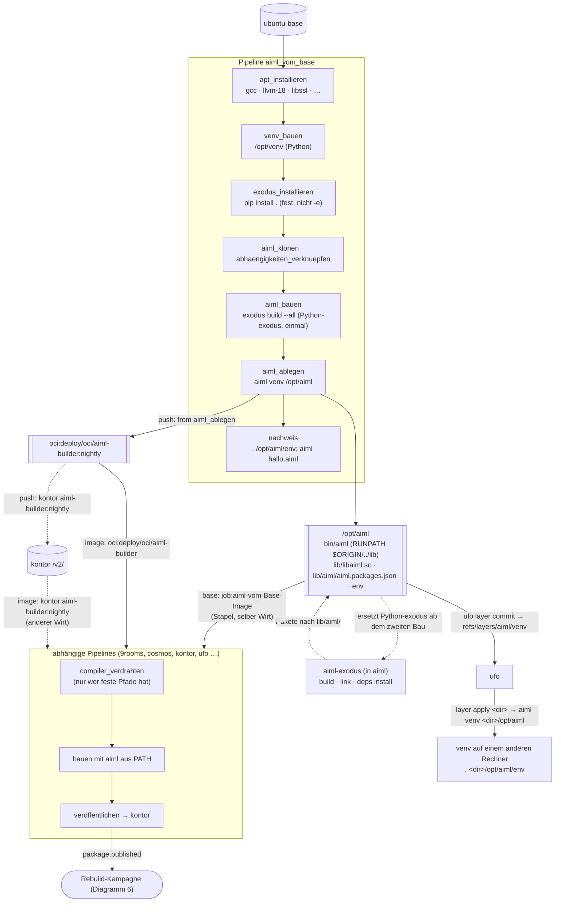

---

## 11. Vertrauensgrenzen

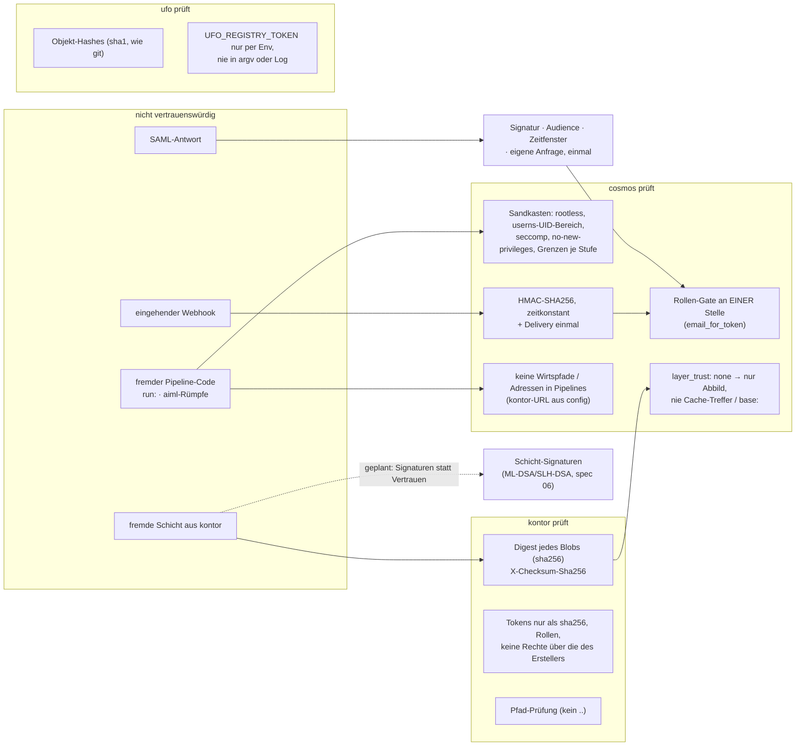

---

## Offene Punkte, die in den Diagrammen gestrichelt sind

- `exodus deps install` (Pakete aus kontor in eine Tabelle) — heute ein Stub; kommt mit
  aiml-exodus.
- `from_code:` im Katalog (F111-5).
- Schicht-Annotationen (`cosmos.stage`, `cosmos.bindings`, …) setzt cosmos-oci noch nicht
  (spec/111 §111.11).
- `ufo layer commit` direkt als Stufe eines cosmos-Laufs: die Bausteine sind da (ufo
  `tests/venv_layer.sh` zeigt den Weg), cosmos verdrahtet ihn noch nicht selbst.
- Fremde Schichten als Cache-Treffer: erst mit Signaturen (F110-121).
- `image: kontor:aiml-builder` statt `oci:` für die venv über Wirtsgrenzen.
